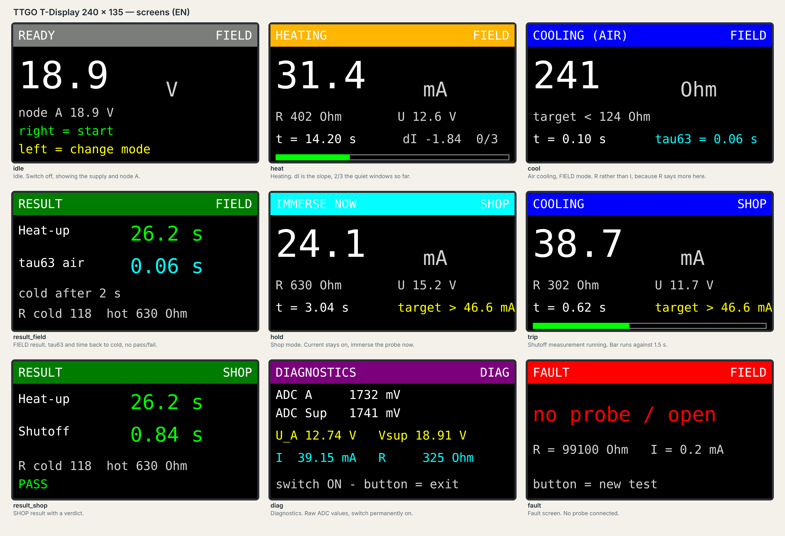
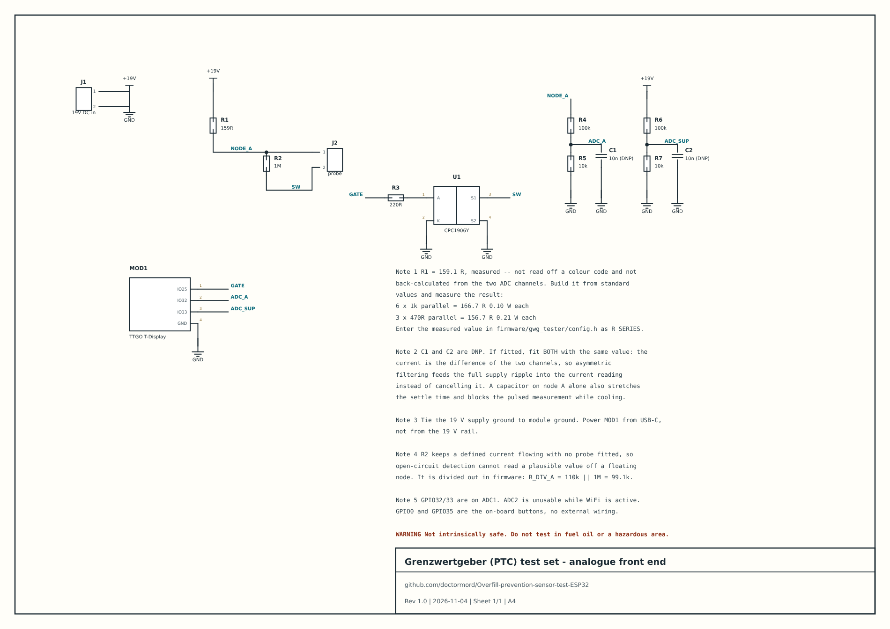
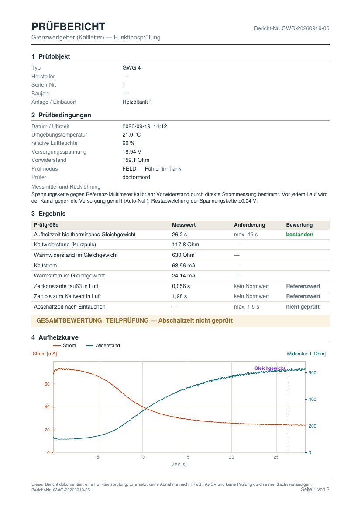

# Overfill prevention sensor test set (ESP32)

A bench instrument that tests the PTC probe of a heating-oil overfill
prevention device — a *Grenzwertgeber*, in German — and writes an A4 test
report as PDF.

The probe is a Kaltleiter: a PTC that self-heats in air, so its resistance
rises and its current falls, and the controller reads *filling permitted*.
Immersed in liquid, the probe is cooled, resistance falls, current rises,
and filling is shut off. This instrument drives a probe from a 19 V supply
through a series resistor, switches it on the low side, and records
current and resistance over time.

> **Not intrinsically safe.** Do not use in fuel oil, in a tank that has
> held fuel oil, or anywhere else that an ignition source is unwelcome.
> This is a bench and service instrument for a probe that has been removed
> or for a dry tank, and it is not a substitute for an acceptance test
> under TRwS / AwSV or for an inspection by a qualified expert.



---

## What it measures, and what it cannot

| Quantity | Mode | Limit |
|---|---|---|
| Heat-up time to thermal equilibrium | FIELD, SHOP | ≤ 45 s |
| Cold and hot resistance, cold and hot current | FIELD, SHOP | — |
| τ63 and time back to cold, in air | FIELD | no standard value |
| Shutoff time after immersion | SHOP | ≤ 1.5 s |

The 1.5 s shutoff criterion needs the probe removed from the tank and
immersed in liquid. Nothing can produce it in situ, which is why service
testers of the GPR 4 class check the heating side only. FIELD mode does the
same and then records the air cooling curve as a fingerprint of the
individual probe — reproducible, and useful against a known good probe of
the same type, but not a pass/fail criterion. The report says so rather
than inventing a limit.

Two things are deliberately **not** guessed:

- **The heating phase ends at thermal equilibrium**, not at a fixed
  current. The current counts as constant once its slope stays below
  0.15 mA/s over three consecutive one-second windows. The heat-up time is
  the start of the first quiet window; the next two only confirm it.
- **The shutoff threshold is derived per probe** at runtime from the two
  measured corner points: `iTrip = iHot + 0.5 · (iCold − iHot)`. A fixed
  milliamp threshold only ever fits one probe type.

## Repository layout

```
firmware/gwg_tester/     the instrument
  gwg_tester.ino           state machine, measurement, display
  config.h                 everything that depends on your hardware sample
  strings.h  strings_de.h  strings_en.h   compile-time language
  build_opt.h              TFT_eSPI configuration, passed as compiler flags
firmware/adc_scan/       finds which ADC1 pin your divider is on
hardware/                KiCad schematic, SVG, BOM, generator script
tools/report-generator/  one HTML file: Web Serial in, PDF out
docs/                    serial protocol, display mock-ups, example report
data/                    a real measurement log
```

---

## Hardware



<sub>Also as [SVG](hardware/gwg-tester.svg) and as a KiCad project in [`hardware/`](hardware/).</sub>

Full parts list and the traps worth knowing about:
[`hardware/BOM.md`](hardware/BOM.md). The schematic opens in KiCad 8
(`hardware/gwg-tester.kicad_pro`); its symbols are local to the project, so
nothing needs installing. Both the `.kicad_sch` and the `.svg` above are
generated by `hardware/generate_schematic.py` from one placement table, so
they cannot drift apart, and the script checks that every pin lands on a
wire before it writes anything.

The measurement is a two-channel voltage measurement and nothing else:

```
I     = (Vsup − U_A) / R_SERIES − U_A / R_DIV_A
R_PTC = U_A / I − R_SWITCH
```

Both channels are sampled interleaved, so supply ripple appears in both
halves of the difference and cancels. That only holds while both dividers
are loaded identically — which is why C1 and C2 are marked DNP and why
fitting a capacitor on node A alone makes the instrument worse, not better.

---

## Firmware

### Prerequisites

- Arduino IDE 1.8.13 or newer, or 2.x — older versions do not read
  `build_opt.h` and the firmware will refuse to compile rather than fail
  later as a black display
- ESP32 board package (tested 3.3.11), board *ESP32 Dev Module*
- TFT_eSPI library (tested 2.5.43)

### Display configuration

**Nothing in TFT_eSPI needs editing.** `User_Setup_Select.h` and
`User_Setup.h` stay as they came. The configuration lives in
`firmware/gwg_tester/build_opt.h`, whose lines the IDE passes as compiler
flags to every translation unit, libraries included.

This matters because TFT_eSPI is compiled separately from the sketch, so
`#define`s in the sketch never reach it. Edit the library instead and the
project works on exactly one machine — and the failure mode when it does
not is a black screen at runtime, not a compiler error. Two `#error` guards
at the top of the sketch turn that into a build failure instead.

### Language

Set it in `config.h`:

```c
#define GWG_LANG 0   // 0 = German, 1 = English
```

or override it from `build_opt.h` with `-DGWG_LANG=1`. The strings are
plain `#define`s in `strings_de.h` / `strings_en.h`, so exactly one set is
compiled in and the other costs nothing. Adding a language means adding a
file and one `#elif` in `strings.h`; the sketch body contains no literal
the operator can read.

Only the display and the `##` prose on the serial port are translated. CSV
rows, phase tokens and `# key=value` metadata are the machine interface and
stay fixed, so one report generator reads logs from any unit.

`strings.h` fails the build if a translation is incomplete — a missing
`#define` would otherwise compile cleanly everywhere except the one screen
that uses it.

### Calibration

Values in `config.h` are for the unit this repository was developed on.
Three of them are yours to establish:

1. **`R_SERIES`** — measure it, with a multimeter in series carrying real
   current. Do not back-calculate it from the instrument's own channels;
   see [`hardware/BOM.md`](hardware/BOM.md) for why that is circular.
2. **`DIV_A` / `DIV_SUP`** — set the supply to a known voltage measured
   with a reference meter, read `Vsup` in DIAG mode, and scale.
3. **`CAL_SLOPE` / `CAL_ANCHOR`** — optional. Connect a known resistor,
   compute the true node voltage from `U = Vsup · Rp/(R_SERIES + Rp)` with
   `Rp = R_DMM ∥ R_DIV_A`, then
   `CAL_SLOPE = (U_true − U_shown) / (U_shown − CAL_ANCHOR)`.

Before every run the instrument zeroes channel A against the supply with
the switch off, where the two must agree to within the 27 mV dropped
across R1 by the divider current. That absorbs drift; it does not absorb a
wrong `R_SERIES`.

If the ADC pins seem dead, flash `firmware/adc_scan` — it prints all of
ADC1 at once, and you connect the divider and watch which pin moves.

### Operating

| Button | Function |
|---|---|
| right (GPIO35) | start / continue |
| left (GPIO0) | change mode, in READY only |

**FIELD** — probe stays in the tank. Heats, waits for equilibrium, then
switches off and follows the air cooling curve with short measuring
pulses.

**SHOP** — probe removed, beaker of water ready. Heats, waits for
equilibrium, then holds the current on. Immerse the probe when the display
says so; the instrument detects immersion from the current step and times
the shutoff.

**DIAG** — switch permanently on, raw ADC values on screen. This is the
screen to hold a multimeter against.

During air cooling the probe must not be heated by its own measurement, so
each sample is a short pulse. The on-time is **measured** with `micros()`
and reported, not assumed: an earlier version computed the duty cycle from
the settle delay alone, ignored the time spent averaging, and reported
24 % where the real figure was several times that. The cooling curve
measured that way is biased, and it does not look wrong.

---

## Report generator



[`tools/report-generator/index.html`](tools/report-generator/index.html) —
open the file in a browser. One file, no build step, no dependencies, no
network access: a copy taken today still works on a machine that has never
seen a package registry. The PDF writer is part of it, so the charts are
vector and the file stays small.

1. **Serial verbinden** — pick the tester's port and run a test; the log
   streams in and is parsed live. Needs Chrome, Edge or Opera for Web
   Serial. Any browser can open a saved `.log` file instead.
2. Fill in unit under test, conditions, instruments.
3. **PDF erzeugen** — preview appears inline, then download.

The report is German or English, switched in the form, and the decimal
separator follows. Both protocol versions are read, including the German
prose headers of logs recorded before the protocol was fixed — a report
generator that cannot read the measurements already taken is of no use.

Example output: [German](docs/example-report/GWG-20260919-05_de.pdf) ·
[English](docs/example-report/GWG-20260919-05_en.pdf), both generated from
[`data/2026-09-19_1412_ptc-sample.log`](data/2026-09-19_1412_ptc-sample.log).

Protocol reference: [`docs/serial-protocol.md`](docs/serial-protocol.md).

---

## Known limitations

These are properties of the instrument as built, not things left to do
later. They belong in the open because each one changes how a reading
should be weighed.

- **The measurement chain is verified at 330 Ω, not near 120 Ω.** That is
  where `linearize()` acts most strongly and where a cold probe sits.
  Checking it needs a 4 × 470 Ω parallel network (≈ 117.5 Ω, 136 mW per
  part); until then, treat cold values as less certain than hot ones.
- **The cold reading sits about 4 % below a lead-corrected multimeter
  reading** on the reference probe (119.6 Ω against 124.8 Ω). Part of that
  is the point above; part of it is residual warmth in a probe that was
  energised moments before. It has not been separated.
- **The shutoff time has never been measured** on the reference probe. It
  needs SHOP mode with the probe out of the tank, and that has not been
  run.
- **The air cooling curve has no reference.** It is only meaningful
  against another probe of the same type measured the same way.
- **ADC offset** of roughly +27 mV at the pin is absorbed into the linear
  fit rather than corrected separately, because the residuals showed
  offset and gain, not curvature. A stepwise table fitted to six read-off
  points would have frozen their noise into the firmware.

## Licence

MIT, see [LICENSE](LICENSE).
